# DVL — build étape par étape — V3 (PROPOSAL)

التاريخ: 2026-10-25 — Europe/Paris.
الحالة المرجعية: checkpoint 2026-10-20 (لا قبول ولا freeze جديد).
اقتراح تصحيح لـ`bluid_dvl_etape_by_etape.md` حتى يطابق ترتيب الاعتماد في `DVL_STEP_BY_STEP_BUILD_ROADMAP_V2_AR` (المراحل 00–40).
الأرقام بين [ ] = رقم المرحلة في V2.

التغيير الأساسي: **القانون قبل أول فعل يعدّل.** في الرسم الحالي Kernel يجي في C10 بعد التعديل والـterminal والـgit؛ في V2 هو المرحلة 07، قبل Patch [09] وTerminal [10].
كذلك Evidence/Verification/Integration [14] وCheckpoints [15] وTools-without-LLM [16] لازم قبل Provider [17]، موش بعد الـagent loop.

```mermaid
flowchart TD
    GOAL["DVL Code 😈
Desktop coding agent → Dynamic Project Environment"]

    subgraph FOUNDATION["Baseline — العقود"]
        CORE["Core Contract V0.3.2
FROZEN FOR SPIKE"]
        SPIKE["Kernel / Harness spike H1–H4
macOS؛ 318/318 ×2"]
        ZERO["[00] تثبيت المرجع والأدلة"]
        GAP["مفتوح: سجل قبول 00
ربط H1–H4 بـcommit/logs"]
        CORE --> SPIKE --> ZERO
        ZERO -.-> GAP
    end

    subgraph DESKTOP["الأساس المبني — [01]–[06] جزئيًا، [08]"]
        B["B repair v3 — PASS / FROZEN
Electron 44.7.2 • Projects • Recent
SQLite • Settings • Secrets
يغطي [03] [04] و[06.1–06.2]"]
        C1A["C1a repair v2 — read-only reader
Historical scoped PASS؛ موش frozen"]
        FINDING["C1B-UNICODE-01
C1a F1/N-2 reopened"]
        R1["📍 نحن هنا: C1b V3 auth-tests R1
List • Read • Search — [08.1–08.2]
Automated Mac qualification PASS
CANDIDATE — موش frozen"]
        SCOPE["Scope: macOS 13.7.8 Intel فقط
Apple Silicon / جهاز 8 GB [01.1] غير مثبت"]
        B --> C1A --> R1
        C1A -.-> FINDING -.-> R1
        R1 -.-> SCOPE
    end

    subgraph CLOSE["الباقي قبل قبول C1b"]
        ID["Electron binary hash + cache
discover.cjs"]
        RUNS["5 restored-project launches — 0/5
First-open TIMEOUT • GPU/EGL • logs"]
        REVIEW["Independent review
+ قرار إغلاق Unicode finding"]
        FREEZE["قرار قبول وتجميد C1b"]
        ID --> RUNS --> REVIEW --> FREEZE
    end

    subgraph LAW["C2 — القانون قبل أي تعديل"]
        KERNEL["[07] Kernel binding + Transaction workspace
canonical paths • fencing • supervisor
[06.3–06.6] allow / block / ask + approval"]
        STORE["[05] Event store المعتمد
هوية كل فعل • projector • DB-full/corrupt"]
        KERNEL --> STORE
    end

    subgraph RUNTIME["C3–C8 — Local Runtime تحت Kernel"]
        PATCH["[09] Patch engine → Candidate
hash/currentness • atomic • undo
+ [11] Git snapshot / baseline"]
        TERM["[10] Terminal + Process supervisor
timeouts • kill group • no double-mutation"]
        TESTS["[12] Tests / Build في بيئة معزولة"]
        LIVE["[13] Dev server + Port/URL + Preview
health check • validated checkpoint"]
        EVI["[14] Evidence → Verification → Integration
+ [15] Checkpoints SAFE/UNSAFE"]
        CGATE["[16] Phase C gate — tools بدون LLM
Read → Patch → Test → Server → URL → Stop → Restart"]
        PATCH --> TERM --> TESTS --> LIVE --> EVI --> CGATE
    end

    subgraph AGENT["Single-Worker Agent"]
        PROV["[17] Provider API واحد
+ [18] Usage / Budget / Network limits"]
        LOOP["[19] Single-worker coding loop
+ [20] Stop / Pause / steer"]
        RECOVERY["[21] Recovery فعلي
fresh authority بعد restart"]
        MVP["[22] سلّم مشاريع حقيقية
Single-Worker MVP — GREEN-SCOPED"]
        PROV --> LOOP --> RECOVERY --> MVP
    end

    subgraph SMART["التنسيق الذكي"]
        CTX["[23] Context engine"]
        PLAN["[24] Planning 4 مراحل → [25] URG → [26] Compiler"]
        LIFE["[27] Task → Assignment → Worker
+ [28] Risk hooks"]
        WORKERS["[29] Multi-worker صغير (2 → 3)"]
        ORCH["[30] Orchestrator V0 → [31] Smart Décalage
→ [32] Dynamic replanning"]
        HAND["[33] Multi-provider handoff
+ [34] E/V/I تحت التوازي"]
        CTX --> PLAN --> LIFE --> WORKERS --> ORCH --> HAND
    end

    subgraph PRODUCT["تجربة المنتج الكاملة"]
        SEC["[35] Review / Security / Audit
+ [36] Skills / MCP / Git import"]
        ENV["[37] Dynamic Project Environment / Rooms
+ [38] عدة مشاريع"]
        RELEASE["[39] Scale على 8 GB
→ [40] Packaging • notarization • TCC • Release gate"]
        SEC --> ENV --> RELEASE
    end

    GOAL --> CORE
    ZERO --> B
    R1 --> ID
    FREEZE --> KERNEL
    STORE --> PATCH
    CGATE --> PROV
    MVP --> CTX
    HAND --> SEC

    classDef frozen fill:#d9f2df,stroke:#278442,color:#123d20
    classDef current fill:#fff0bd,stroke:#b58100,color:#503900
    classDef open fill:#ffe0df,stroke:#bd4540,color:#642522
    classDef law fill:#e3e8ff,stroke:#3d55c4,color:#1b2a6b
    classDef future fill:#edf0f5,stroke:#7b8596,color:#293344

    class CORE,B frozen
    class R1 current
    class GAP,FINDING,SCOPE,ID,RUNS,REVIEW,FREEZE open
    class KERNEL,STORE law
    class PATCH,TERM,TESTS,LIVE,EVI,CGATE,PROV,LOOP,RECOVERY,MVP,CTX,PLAN,LIFE,WORKERS,ORCH,HAND,SEC,ENV,RELEASE future
```

